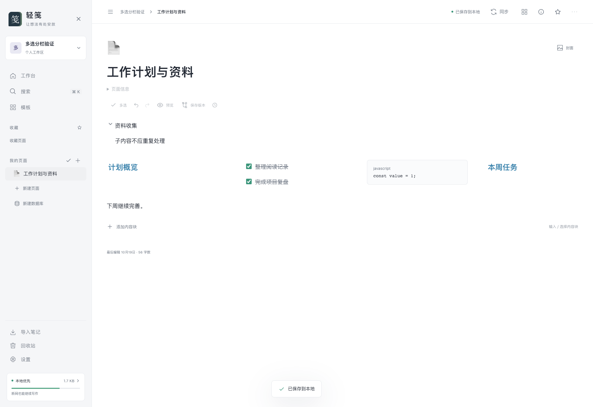
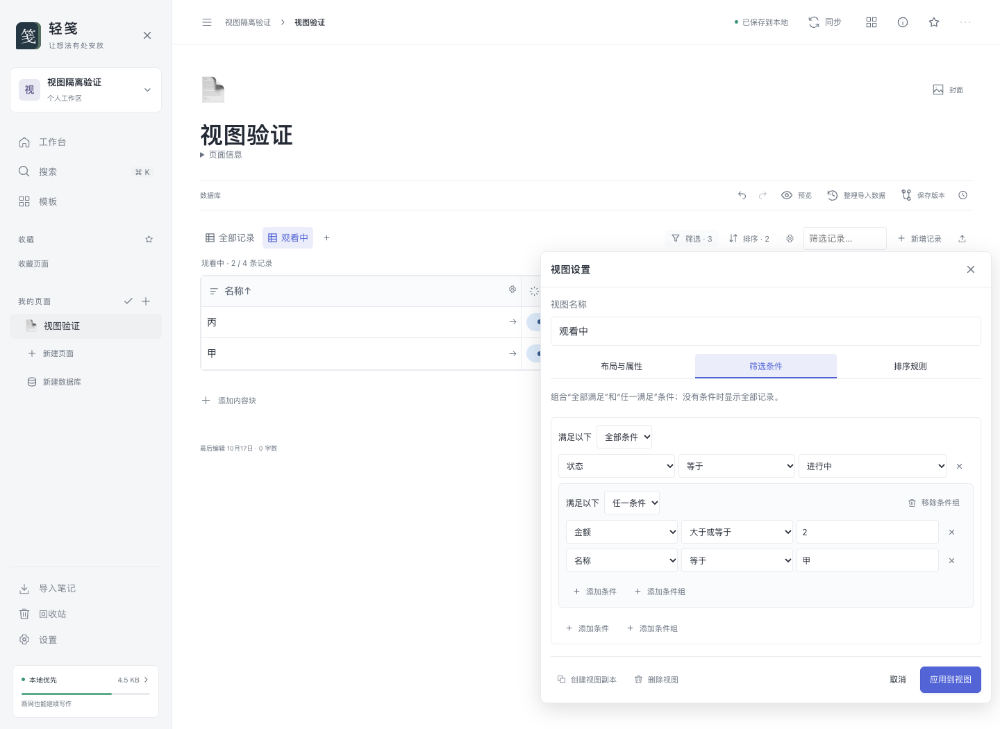
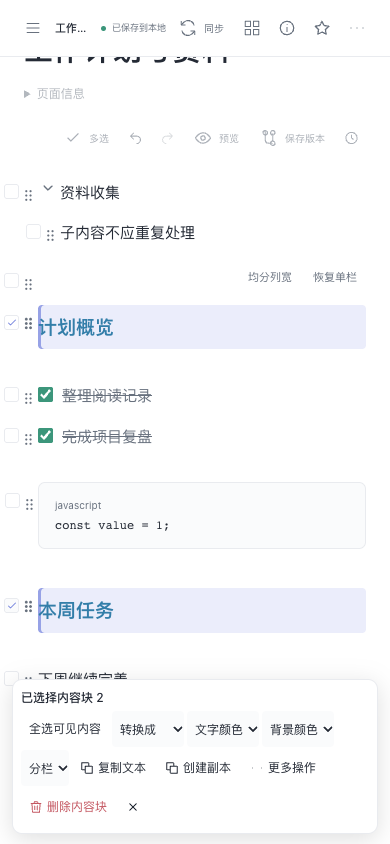

<div align="center">

# 轻笺

让想法有处安放。

本地优先 · 跨平台 · 内容块与数据库 · 多仓库同步

[](https://github.com/a602017206/qingjian/releases/latest)
[](https://github.com/a602017206/qingjian/releases)
[](https://github.com/a602017206/qingjian/releases/latest)
[](https://github.com/a602017206/qingjian/actions/workflows/verify.yml)
[](LICENSE)


[下载最新版](https://github.com/a602017206/qingjian/releases/latest) · [版本历史](https://github.com/a602017206/qingjian/releases) · [使用指南](docs/使用指南.md) · [问题反馈](https://github.com/a602017206/qingjian/issues)

</div>

轻笺是参考 Notion 页面与内容块体验的笔记工具。笔记保存在自己的设备中，可关联 Gitee、GitHub、GitLab 或其他兼容的 HTTPS 远程仓库，不依赖强制云服务。每个工作区对应一个独立仓库，可以同时管理个人、工作和专题笔记。

桌面、安卓与苹果移动端共用网页界面和 Rust 核心。默认简体中文，提供繁体中文设置，并保留可扩展的国际化字典。当前版本为 **0.0.6**。

## 下载与安装

| 平台 | 最新版下载 | 最新版下载量 |
| --- | --- | --- |
| 微软桌面六十四位 | [安装程序](https://github.com/a602017206/qingjian/releases/latest/download/qingjian-windows-x64.exe) |  |
| 苹果桌面自研处理器 | [应用与首次打开说明](https://github.com/a602017206/qingjian/releases/latest/download/qingjian-macos-arm64.zip) |  |
| 苹果桌面英特尔处理器 | [应用与首次打开说明](https://github.com/a602017206/qingjian/releases/latest/download/qingjian-macos-x64.zip) |  |
| Linux 桌面六十四位 | [安装包](https://github.com/a602017206/qingjian/releases/latest/download/qingjian-linux-x64.deb) · [便携包](https://github.com/a602017206/qingjian/releases/latest/download/qingjian-linux-x64.AppImage) |   |
| 安卓六十四位 | [固定签名安装包](https://github.com/a602017206/qingjian/releases/latest/download/qingjian-android-arm64.apk) |  |
| 苹果手机真机，自行签名 | [未签名包](https://github.com/a602017206/qingjian/releases/latest/download/qingjian-ios-unsigned-arm64.ipa) |  |
| 苹果手机模拟器，自研处理器电脑 | [模拟器应用](https://github.com/a602017206/qingjian/releases/latest/download/qingjian-ios-simulator-arm64.zip) |  |

[首版 0.0.1](https://github.com/a602017206/qingjian/releases/tag/v0.0.1) · [全部标签](https://github.com/a602017206/qingjian/tags) · [文件摘要](https://github.com/a602017206/qingjian/releases/latest/download/SHA256SUMS.txt)

每个版本使用独立标签，例如 `v0.0.1`；历史版本的下载地址保持在对应标签下，最新版链接自动指向当前正式版本。所有必要平台构建和验证成功后才发布，不以空文件或失败构建替代安装包。

下载徽章由第三方服务读取公开的版本资产计数，包含安装包及校验文件下载，不等同于独立用户数；访问次数仅统计说明页徽章请求。轻笺应用没有接入这些统计服务。

### 首次打开

- 苹果桌面：解压后将应用拖入“应用程序”。若首次被系统拦截，先尝试打开，再进入「系统设置 → 隐私与安全性 → 仍要打开」。包内有中文说明，无需执行终端命令。应用使用免费临时签名，尚未经过苹果开发者签名与公证。
- 微软桌面：运行安装程序。当前未购买代码签名证书，系统可能显示未知发行者；先确认下载来源及所用版本。应用依赖系统网页运行组件，安装程序会处理相关依赖。
- Linux 桌面：按自己的发行版选择安装包或便携包。便携包需要执行权限，系统依赖与兼容边界见[构建与发布](docs/构建与发布.md)。
- 安卓：允许从所选下载来源安装应用后安装。正式发布包使用固定自签名密钥，不需要购买证书；后续同签名版本可覆盖升级。安装到不同处理器或受限制设备前，请确认兼容性。
- 苹果手机：未签名包不能直接安装；可以使用自己的免费账号重新签名，通常每七天续签。模拟器包不能安装到真机。详见[苹果手机免费安装说明](docs/苹果手机免费安装说明.md)。

## 手机与多设备同步

手机表格名称可直接打开记录，属性与内容块在底部面板编辑，支持软键盘避让、折叠嵌套、多选批量操作和斜线插入。桌面与手机共用界面和数据结构。

**设备无需安装 Git，也不需要输入命令。** 轻笺内置同步库；首次点击同步会提供中文引导。第一台设备上传到专用私有空仓库，新设备下载到独立工作区。可勾选记住工作区认证，由本机系统安全凭据库保存；浏览器服务仅支持本次运行。不同笔记自动合并，同一笔记的冲突在应用内选择保留版本；首次连接已有仓库可选择以本机、远程为准或合并。覆盖前保留双方恢复点，合并保留双方历史，不强制推送。详细步骤见[使用指南](docs/使用指南.md)。

自动同步目前先以测试包提供，正式零点零点六尚未包含。测试构建中，已关联仓库的工作区默认开启自动同步：打开应用、回到前台检查，编辑保存并停止操作约四秒后同步，前台每两分钟补查。离线保存后联网重试；冲突暂停，核对双方后选择。设置可按工作区关闭，应用退出或被系统结束时不在后台同步。

测试构建另增加数据库记录多选：五种视图勾选、连续扩选、批量属性编辑、所选导出、记录副本及确认移除；手机使用底部弹层。含独立子页的记录暂不提供整批复制，移除行保留独立子页正文，详见[数据库指南](docs/表格与高级数据库指南.md#数据库记录多选与批量操作测试构建)。这些改进尚未正式发布。

安卓与桌面均可记住工作区认证，退出或强制结束应用后无需重复输入。首次升级仍需填写一次真实用户名和访问令牌；认证不会随笔记同步到其他设备。

## 客户端更新

从 `0.0.2` 起，「设置 → 关于轻笺」显示实际版本，支持检查更新和下载当前系统、架构对应的安装包。原生客户端启动后、每小时以及回到前台时按间隔检查正式版本，有更新时提示；可以关闭自动检查或暂不提醒某一版本。检查仅请求本项目公开版本信息，不上传笔记或认证信息，网络失败不影响离线使用。

版本标签需要先通过全部构建和启动测试、完成正式发布，客户端才会提示。不会静默安装、降级，也不会给未知架构下载其他平台文件；下载由系统浏览器处理。苹果手机仍需自行重新签名，不能直接安装未签名文件。

**`0.0.1` 没有更新检查入口，需要先手动安装一次新版。** 安卓升级继续使用同一签名，不要先卸载以免清除本地数据。浏览器预览无法可靠获取实际客户端架构，需要手动选择下载平台。

## 功能

| 能力 | 当前实现 |
| --- | --- |
| 页面管理 | 页面树、子页面折叠、收藏、标签、封面、图标、全宽与阅读布局、侧栏收起、右键菜单、复制与移动 |
| 块编辑 | 文本、六级标题、列表、待办、引用、提示框、代码、分隔线、折叠、简易表格、图片及附件 |
| 编辑交互 | 就地斜线搜索、嵌套、整组拖动、多选批量操作、拖拽分栏与列宽调整、键盘缩进、撤销重做 |
| 文档粘贴 | 标题、列表、待办、围栏代码、链接、表格和常用行内符号；复杂原文保留为源码编辑 |
| 数据库 | 表格、看板、列表、图库、日历，命名视图、组合筛选、多层排序和独立显示属性 |
| 数据库属性 | 二十二种本地属性，彩色状态与选择、日期、人员、文件、函数、关联、汇总及系统元信息等 |
| 记录与页面 | 数据库记录正文、独立子页面、侧边预览、页面链接、反向链接与目录 |
| 多仓库同步 | 独立工作区、内置同步、不同笔记自动合并、冲突版本选择、双方恢复点与普通推送 |
| 迁移与备份 | 原工具压缩包、文档与表格、网页导入；结构化页面、表格及附件备份导出与恢复 |
| 空间管理 | 笔记、附件和版本历史的真实用量，批量回收、永久清理与共享附件保护，工作区移除、恢复与永久删除 |
| 外观 | 浅色、深色、跟随系统、正文字体和简繁中文设置；手机采用同一套响应式界面 |

### 界面预览



<details>
<summary>查看数据库与手机界面</summary>





</details>

### 当前边界

本版本不包含实时多人协作、完整评论权限系统、智能总结与翻译填充，也不保证完整兼容第三方公式语言。导出文件中本来缺失的属性类型、选项颜色、公式及关联信息无法凭空恢复，导入报告会给出可恢复范围。

完整迁移请使用轻笺结构化备份。独立文档导出按列顺序保留正文，不承载全部分栏与数据库结构。清空回收站不会强制改写仓库历史；版本历史仍可能保留旧内容和占用磁盘。

手机使用共享界面不等于已完成所有真机验收。文件提供器、软键盘、安全区域、签名续期及不同系统的权限行为仍需持续实机验证。详细范围见[产品设计与功能范围](docs/产品设计与功能范围.md)。

## 数据与隐私

笔记首先写入本地工作区；关联仓库后，应用在前台自动同步，也可手动同步。工作区相互独立，私有笔记不会上传到本项目源码仓库。仓库的公开或私有状态由你选择，请勿把私人笔记误推送到公开仓库。

访问令牌可由本机系统安全凭据库记住，不写入笔记、同步仓库或源码；项目不自动强制推送、不覆盖分叉历史。笔记和附件可导出，恢复前建议保留原始备份。工作区路径可在应用设置中的数据页面查看。

## 本机开发

需要 Node.js 22、Rust 稳定工具链和对应系统的 Tauri 桌面依赖；苹果桌面打包还需要 Python 3。先参阅[官方环境要求](https://v2.tauri.app/start/prerequisites/)。

```bash
git clone https://github.com/a602017206/qingjian.git
cd qingjian
npm ci
npm run dev
```

随后打开 `http://127.0.0.1:3415`。开发预览数据保存在 `.data/`，与原生应用数据目录分离，不进入源码仓库。

```bash
npm run desktop:dev
npm run desktop:build
```

苹果桌面构建会自动临时签名、严格校验并生成带中文首次打开说明的分发包。已有正式应用时可以只重新封装：

```bash
npm run desktop:package:macos
```

### 各平台构建

| 平台 | 构建入口 | 产物 |
| --- | --- | --- |
| 当前桌面平台 | `npm run desktop:build` | 当前系统安装包；苹果自动生成校验后的压缩包 |
| 微软、苹果两种处理器与其他桌面 | 仓库工作流中的「桌面应用构建」 | 四个构建任务、五种分发文件 |
| 安卓 | 云端执行 `npm run mobile:android` 后签名校验 | 固定签名发布安装包 |
| 苹果手机模拟器 | 云端执行 `npm run mobile:ios` | 模拟器应用压缩包 |
| 苹果手机未签名真机 | 云端执行 `npm run mobile:ios-device` | 供使用者重新签名的手机包 |

**移动端原生编译和构建只在云端执行。** 本机入口会拒绝移动构建，不需要本机配置移动签名和开发者账号。安卓密钥保存在仓库机密配置中，不能提交到源码。生成工程、系统依赖和各架构完整命令见[构建与发布](docs/构建与发布.md)。

## 标签版本发布

发布流程会核对前端清单、锁文件、核心、原生应用和配置版本，必须全部一致。更新版本时，同时准备对应的中文发布说明，再创建标签；不能覆盖已发布标签或重写公开历史。

```bash
npm run release:check
git tag -a v0.0.5 -m "发布轻笺 0.0.5"
git push origin main
git push origin v0.0.5
```

标签触发共享验证、全部桌面和移动端构建。所有任务通过后，流程整理八种平台文件、生成摘要、创建版本草稿，上传完整文件后正式发布。失败时保留日志与构建产物，不把不完整版本设为最新版。手动重新运行发布流程需要选择已经存在且与代码版本一致的标签。

## 验证与贡献

```bash
npm test
npm run check
npm run build
cargo test --locked -p notebook-core
cargo clippy --locked -p notebook-core --all-targets -- -D warnings
npm run test:e2e:editor
node scripts/check-docs.mjs
```

测试使用匿名样本和隔离目录，不修改真实工作区。欢迎通过[问题反馈](https://github.com/a602017206/qingjian/issues)提交可复现步骤，或通过合并请求贡献改进；请勿附带令牌、私钥或未脱敏笔记。

项目采用 [Apache 2.0](LICENSE)；标准许可证文件保留原条款，使用说明及协作文档为中文。第三方依赖遵循各自许可证。

## 文档与变更记录

- [使用指南](docs/使用指南.md)
- [表格与高级数据库指南](docs/表格与高级数据库指南.md)
- [苹果手机免费安装说明](docs/苹果手机免费安装说明.md)
- [构建与发布](docs/构建与发布.md)
- [架构与数据格式](docs/架构与数据格式.md)
- [产品设计与功能范围](docs/产品设计与功能范围.md)
- [验证报告](docs/验证报告.md)
- [每日记录](docs/每日记录/)

每次设计、修改和修复均追加到当天唯一记录，按北京时间命名，不覆盖已有内容。协作约定见[项目约定](AGENTS.md)。
